# 🎓 ProfeLink — Evaluaciones en Vivo (Kahoot V/F)
> **MOC (Map of Content)** principal del sistema de evaluaciones rápidas en tiempo real para **ProfeLink**.

---

## 📌 Resumen Ejecutivo
Sistema autónomo de evaluaciones formativas en tiempo real tipo **Kahoot (Verdadero/Falso)** diseñado para mantener la atención estudiantil durante las clases de programación. El sistema desacopla la autenticación mediante un servicio independiente (`auth-service`) con validación de audiencia JWT (`aud: "profelink-game-api"`), implementa un motor de juego en vivo con **WebSockets (Socket.io)** y **Arquitectura en Capas (Layered Architecture - Layers)** en NestJS, expone APIs documentadas en **OpenAPI/Scalar** para integración de terceros, cuenta con observabilidad distribuida (**OpenTelemetry + Grafana**) y asegura su calidad con suites completas de **Jest** y **Playwright**.

---

## 🗺️ Mapa de Navegación del Proyecto

```mermaid
graph TD
    MOC["00 - MOC ProfeLink"]
    
    subgraph "01 - Requerimientos"
        REQ1["Enunciado del Proyecto"]
        REQ2["Casos de Uso"]
        REQ3["Reglas del Juego y Negocio"]
    end
    
    subgraph "02 - Arquitectura y Diseño"
        ARQ1["Arquitectura del Sistema"]
        ARQ2["Diseño Interno (Arquitectura en Layers)"]
        ARQ3["Modelo de Datos (ERD)"]
        ARQ4["Diagrama de Clases"]
    end
    
    subgraph "03 - Contratos"
        CON1["Auth Service API"]
        CON2["Game Service API"]
        CON3["Eventos WebSockets"]
        CON4["OpenSpec y PRs"]
    end
    
    subgraph "04 - Infraestructura"
        INF1["Docker y Compose"]
        INF2["Variables y Secretos"]
        INF3["Observabilidad (OTel/Grafana)"]
        INF4["Script de Inicio y Seed"]
    end
    
    subgraph "05 - Calidad y Testing"
        TST1["Estrategia Jest"]
        TST2["Casos de Prueba de Juego"]
        TST3["Pruebas E2E (Playwright)"]
    end
    
    subgraph "06 - Entrega y Defensa"
        ENT1["Checklist de Verificación"]
        ENT2["Guión de Demostración"]
        ENT3["Bitácora de Aportes"]
    end

    MOC --> REQ1 & REQ2 & REQ3
    MOC --> ARQ1 & ARQ2 & ARQ3 & ARQ4
    MOC --> CON1 & CON2 & CON3 & CON4
    MOC --> INF1 & INF2 & INF3 & INF4
    MOC --> TST1 & TST2 & TST3
    MOC --> ENT1 & ENT2 & ENT3
```

---

## 📂 Índice de Contenidos

### [[01 - Requerimientos y Alcance/Enunciado del Proyecto|01 - Requerimientos y Alcance]]
- [[01 - Requerimientos y Alcance/Enunciado del Proyecto|Enunciado del Proyecto]]: Contexto académico, problema, alcance funcional y objetivos.
- [[01 - Requerimientos y Alcance/Casos de Uso|Casos de Uso]]: Especificación detallada de casos de uso por rol (Anfitrión y Participante).
- [[01 - Requerimientos y Alcance/Reglas del Juego y Negocio|Reglas del Juego y Negocio]]: Puntajes, inmutabilidad, aislamiento de salas y validaciones de tiempo.

### [[02 - Arquitectura y Diseno/Arquitectura del Sistema|02 - Arquitectura y Diseño]]
- [[02 - Arquitectura y Diseno/Arquitectura del Sistema|Arquitectura del Sistema]]: Topología de microservicios autónomos, monorepo `pnpm`, justificación técnica.
- [[02 - Arquitectura y Diseno/Diseno Interno (Arquitectura en Capas - Layers)|Diseño Interno (Arquitectura en Capas - Layers)]]: Capa de Presentación, Capa de Lógica de Negocio/Servicios, Capa de Acceso a Datos y Capa de Entidades en NestJS.
- [[02 - Arquitectura y Diseno/Modelo de Datos (ERD)|Modelo de Datos (ERD)]]: Esquema relacional de base de datos en PostgreSQL.
- [[02 - Arquitectura y Diseno/Diagrama de Clases|Diagrama de Clases]]: Clases del dominio, atributos, métodos y máquina de estados de la sala.

### [[03 - Contratos y Especificaciones/Auth Service API (OpenAPI)|03 - Contratos y Especificaciones]]
- [[03 - Contratos y Especificaciones/Auth Service API (OpenAPI)|Auth Service API (OpenAPI)]]: Endpoints de autenticación, emisión de JWT y claim `aud`.
- [[03 - Contratos y Especificaciones/Game Service API (OpenAPI)|Game Service API (OpenAPI)]]: CRUD de Quizzes, preguntas, subida de imágenes y consulta de resultados.
- [[03 - Contratos y Especificaciones/Eventos WebSockets (Socket.io)|Eventos WebSockets (Socket.io)]]: Diccionario de eventos bidireccionales, payloads y diagramas de secuencia.
- [[03 - Contratos y Especificaciones/OpenSpec y PRs|OpenSpec y PRs]]: Ciclo de especificaciones ágiles, trazabilidad y control de cambios.

### [[04 - Infraestructura y Despliegue/Docker y Compose|04 - Infraestructura y Despliegue]]
- [[04 - Infraestructura y Despliegue/Docker y Compose|Docker y Compose]]: Definición de contenedores, redes y volúmenes persistentes (`pgdata`, `quiz_images`).
- [[04 - Infraestructura y Despliegue/Variables de Entorno y Secretos|Variables de Entorno y Secretos]]: Catálogo completo de configuración y `.env.example`.
- [[04 - Infraestructura y Despliegue/Observabilidad (OTel y Grafana)|Observabilidad (OTel y Grafana)]]: Instrumentación de métricas y trazas con OpenTelemetry Collector y Grafana.
- [[04 - Infraestructura y Despliegue/Script de Inicio y Seed|Script de Inicio y Seed]]: Automatización con `start.sh` / `start.ps1` y carga de datos iniciales de prueba.

### [[05 - Calidad y Pruebas/Estrategia de Pruebas Unitarias (Jest)|05 - Calidad y Pruebas]]
- [[05 - Calidad y Pruebas/Estrategia de Pruebas Unitarias (Jest)|Estrategia de Pruebas Unitarias (Jest)]]: Pruebas de reglas de negocio puras en milisegundos sin mocks pesados.
- [[05 - Calidad y Pruebas/Casos de Prueba de Juego|Casos de Prueba de Juego]]: Matriz de las 6 comprobaciones obligatorias de evaluación.
- [[05 - Calidad y Pruebas/Pruebas E2E (Playwright)|Pruebas E2E (Playwright)]]: Simulación multi-jugador en tiempo real con navegadores automatizados.

### [[06 - Entrega y Defensa/Checklist de Verificacion|06 - Entrega y Defensa]]
- [[06 - Entrega y Defensa/Checklist de Verificacion|Checklist de Verificación]]: Tabla de control previo al examen con los 40 puntos evaluados.
- [[06 - Entrega y Defensa/Guion de Demostracion en Clase|Guión de Demostración en Clase]]: Paso a paso para la defensa y banco de respuestas a preguntas del profesor.
- [[06 - Entrega y Defensa/Bitacora de Aportes|Bitácora de Aportes]]: Registro de participación individual, ramas de Git y Pull Requests.

---

## 🛠️ Stack Tecnológico Oficial
| Componente | Tecnología | Rol en la Solución |
| :--- | :--- | :--- |
| **Frontend Principal** | React 18 + Vite + TailwindCSS | Interfaz del profesor (control) y alumno (juego). |
| **Cliente Externo** | HTML5 / JS Vanilla / Micro-React | Demostración de consumo de API de terceros. |
| **Auth Service** | NestJS + TypeScript + JWT | Emisión de tokens con firma criptográfica y audiencia. |
| **Game Service** | NestJS + Socket.io + Clean Arch | Lógica de negocio, temporizadores, WebSockets y CRUD. |
| **Persistencia** | PostgreSQL | Almacenamiento relacional de usuarios, quizzes y partidas. |
| **Observabilidad** | OpenTelemetry + Grafana | Trazas distribuidas, métricas de latencia y dashboards. |
| **Testing** | Jest + Supertest + Playwright | Pruebas unitarias, de integración y E2E. |
| **Infraestructura** | Docker Compose + Volúmenes | Despliegue reproducible en una sola instrucción (`start.sh`). |
