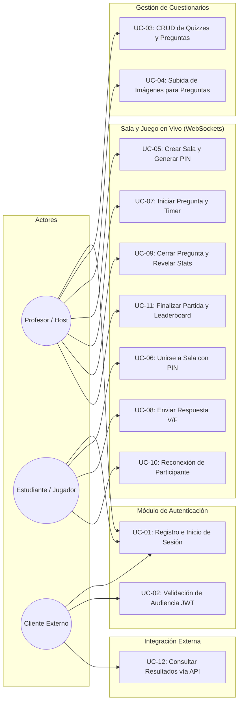

# 👥 Casos de Uso del Sistema

Este documento desglosa las interacciones funcionales de los diferentes actores con la plataforma **ProfeLink - Evaluaciones en Vivo**.

---

## 🎭 Actores del Sistema
1. **Profesor / Anfitrión (Host):** Usuario autenticado con privilegios para crear y administrar cuestionarios, aperturar salas en vivo y moderar el ritmo del juego.
2. **Estudiante / Participante (Player):** Usuario que se une a una sala activa mediante un PIN y su cuenta/nombre, recibe preguntas y envía respuestas.
3. **Cliente Externo (Third-Party Consumer):** Aplicación o script independiente que interactúa con la API REST pública usando tokens válidos emitidos por `auth-service`.

---

## 📊 Diagrama General de Casos de Uso

---

## 📝 Especificación Detallada de Casos de Uso

### UC-01: Registro e Inicio de Sesión
- **Actor:** Profesor, Estudiante, Cliente Externo.
- **Precondición:** Ninguna.
- **Flujo Principal:**
  1. El actor envía credenciales (`email` y `password`) a `POST /api/auth/login`.
  2. `auth-service` verifica el hash de contraseña (bcrypt/argon2).
  3. `auth-service` emite un token JWT firmado con el claim `aud: "profelink-game-api"`.
  4. El cliente almacena el token para llamadas HTTP subsecuentes y el handshake del WebSocket.

### UC-03: CRUD de Cuestionarios y Preguntas
- **Actor:** Profesor (Host).
- **Precondición:** Usuario autenticado con token válido.
- **Regla de Negocio:** Solo el creador (`ownerId`) puede modificar o eliminar un cuestionario.
- **Flujo:**
  1. El profesor consulta sus cuestionarios existentes (`GET /api/quizzes`).
  2. El profesor crea un cuestionario (`POST /api/quizzes`) con título y descripción.
  3. El profesor añade preguntas con enunciado de texto, respuesta booleana (`true`/`false`) y tiempo límite en segundos.

### UC-04: Subida de Imágenes para Preguntas
- **Actor:** Profesor (Host).
- **Precondición:** Pregunta creada previamente.
- **Validaciones:**
  - Formato MIME permitido: `image/jpeg`, `image/png`, `image/webp`.
  - Tamaño máximo: $\le 5\text{ MB}$.
- **Persistencia:** La imagen se guarda en el volumen montado en el contenedor (`/app/uploads`) y se genera una URL estática accesible por la red interna/externa.

### UC-05: Crear Sala y Generar PIN
- **Actor:** Profesor (Host).
- **Precondición:** Poseer al menos un cuestionario con preguntas válidas.
- **Flujo:**
  1. El profesor selecciona el cuestionario y solicita abrir una sala (`POST /api/sessions`).
  2. El servidor genera un código PIN alfanumérico único de 6 caracteres (ej. `K9X2P1`).
  3. Se inicializa el estado de la sesión en `WAITING`.
  4. El profesor conecta su socket a la sala (`room:join`).

### UC-06: Unirse a Sala con PIN
- **Actor:** Estudiante (Participante).
- **Precondición:** Sala en estado `WAITING` o `QUESTION_ACTIVE`.
- **Flujo:**
  1. El estudiante ingresa el PIN y su nombre en el frontend.
  2. El cliente establece conexión WebSocket enviando el JWT en `auth.token`.
  3. Emite `room:join` con `{ roomCode }`.
  4. El servidor valida la existencia de la sala, agrega al participante a la lista y emite `room:participant_joined` a todos los conectados.

### UC-07: Iniciar Pregunta y Lanzar Temporizador
- **Actor:** Profesor (Host).
- **Precondición:** Sala con al menos un participante; sesión iniciada.
- **Flujo:**
  1. El anfitrión presiona "Siguiente Pregunta" emitiendo `game:start_question`.
  2. El servidor valida que el socket emisor sea el `hostId` de la sala.
  3. Cambia el estado a `QUESTION_ACTIVE`, calcula `expiresAt = now + timeLimit`.
  4. Emite `game:question_opened` a la sala conteniendo enunciado, imagen y tiempo, **omitiendo estrictamente la respuesta correcta**.

### UC-08: Enviar Respuesta V/F
- **Actor:** Estudiante (Participante).
- **Precondición:** Pregunta en estado `QUESTION_ACTIVE` y tiempo vigente.
- **Flujo:**
  1. El estudiante presiona el botón "Verdadero" o "Falso".
  2. Emite `game:submit_answer` con `{ roomCode, questionId, answer: boolean }`.
  3. El servidor valida:
     - Que la sesión esté en `QUESTION_ACTIVE`.
     - Que $\text{timestamp} \le \text{expiresAt}$.
     - Que el participante no haya respondido previamente esta misma pregunta.
  4. Se registra la respuesta y se calcula el puntaje (1 si es correcta, 0 si no).
  5. Se emite confirmación privada al jugador.

### UC-10: Reconexión de Participante
- **Actor:** Estudiante (Participante).
- **Precondición:** Pérdida momentánea de red o recarga involuntaria de página.
- **Flujo:**
  1. El cliente restablece el socket y emite `room:join` con su token de usuario y el PIN.
  2. El servidor detecta que el `userId` ya figuraba como participante en la sesión.
  3. Actualiza el `socketId` asociado sin duplicar al jugador en la lista.
  4. Emite inmediatamente `room:state_sync` al reconectado con: pregunta activa, tiempo restante, puntaje acumulado y si ya respondió en esta ronda.

### UC-12: Consultar Resultados vía API (Consumo Externo)
- **Actor:** Cliente Externo.
- **Precondición:** Autenticado con token emitido por `auth-service`.
- **Flujo:**
  1. El cliente externo consulta `GET /api/sessions/{id}/results`.
  2. `game-service` valida el claim `aud: "profelink-game-api"`.
  3. Retorna el resumen consolidado de participantes, aciertos, fallos y podio final en formato JSON.

---

## 🔗 Enlaces Relacionados
- [[00 - MOC ProfeLink|Volver al MOC]]
- [[Reglas del Juego y Negocio|Reglas de Juego y Puntuación]]
- [[03 - Contratos y Especificaciones/Eventos WebSockets (Socket.io)|Especificación de Eventos WebSockets]]
