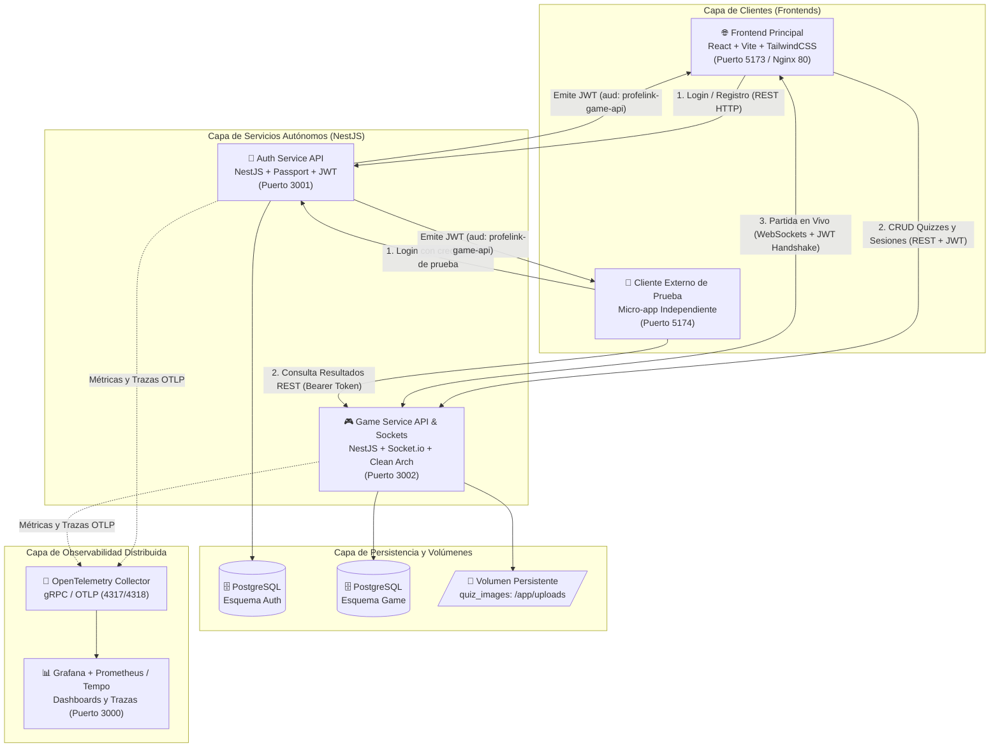
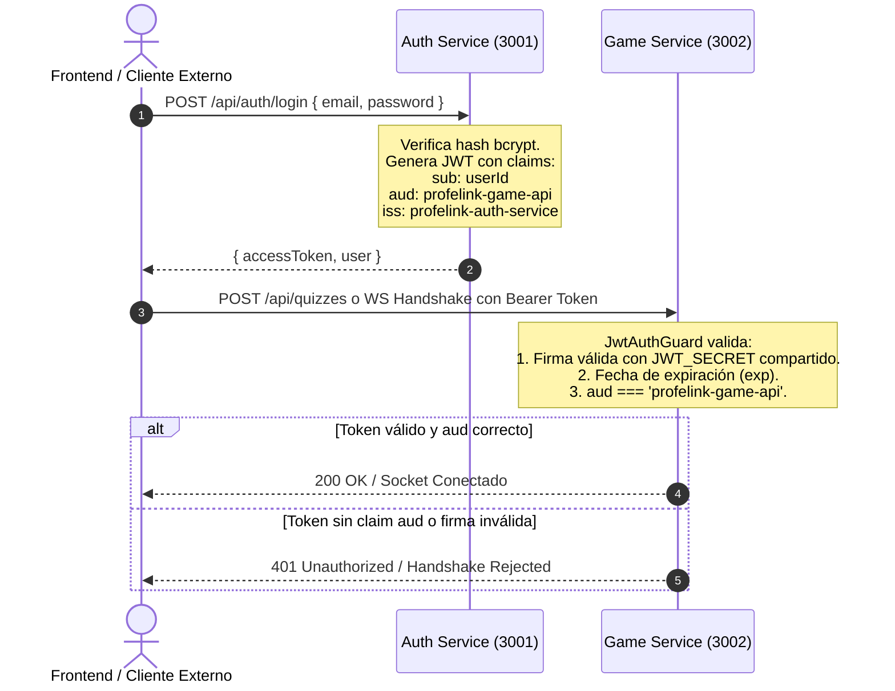

# 🏗️ Arquitectura del Sistema: Servicios Autónomos

Este documento define la arquitectura general del sistema **ProfeLink - Evaluaciones en Vivo**, sus límites de contexto (Bounded Contexts), esquemas de comunicación y la justificación técnica requerida para la defensa ante el profesor.

---

## 🏛️ 1. Estilo Arquitectónico: Microservicios Autónomos en Monorepo

Se implementa una arquitectura basada en **Servicios Autónomos (Microservicios Ligeros)** coordinados mediante un monorepo gestionado por `pnpm workspaces`:

```
profelink-monorepo/
├── apps/
│   ├── auth-service/        # API NestJS: Autenticación, Usuarios y Emisión de JWT
│   ├── game-service/        # API NestJS: Kahoot Engine, Quizzes, WebSockets
│   ├── web-client/          # SPA React + Vite + Tailwind: Profesor y Alumnos
│   └── external-consumer/   # Micro-app web / script: Demostración de cliente tercero
├── packages/
│   └── shared-dtos/         # Tipos compartidos, contratos y payloads de eventos
├── docker-compose.yml       # Orquestación de infraestructura local
└── openspec/                # Especificaciones de cambio y contratos
```

---

## 🗺️ 2. Diagrama de Topología del Sistema



---

## 🔍 3. Justificación de Decisiones Arquitectónicas (Para Defensa)

> [!abstract] Pregunta Típica de Evaluación
> **"¿Por qué separar la autenticación de la lógica del juego en servicios autónomos en vez de un monolito tradicional?"**

### 3.1 Justificación Técnica
1. **Requisito Específico de Auditoría:** El profesor exige demostrar que el API de juego puede ser consumida por terceros independientes reconociendo al servicio de autenticación como proveedor de identidad verificado mediante el claim `aud` (audience).
2. **Ciclos de Escalabilidad Diferenciados:**
   - `auth-service` recibe ráfagas bajas a moderadas de peticiones HTTP (login, validación de perfil).
   - `game-service` sostiene cientos de conexiones persistentes síncronas de WebSocket durante una clase, transmitiendo ráfagas simultáneas de eventos por segundo.
   - Si el motor de juego experimenta saturación, el servicio de autenticación sigue operando con normalidad.
3. **Desacoplamiento de Persistencia:** Ningún servicio accede directamente a la base de datos del otro. Toda interacción se realiza a través de contratos de API REST documentados con OpenAPI.

### 3.2 Compromisos y Costos (Trade-offs)
- **Complejidad de Red y Orquestación:** Requiere gestionar múltiples puertos, variables de entorno cruzadas y orquestación con Docker Compose.
- **Manejo de Errores y Tiempos de Red:** Se debe mitigar fallos transitorios mediante healthchecks y tolerancia a fallos.
- **Monitoreo Distribuido:** Hace imprescindible la inclusión de **OpenTelemetry** para rastrear peticiones que cruzan ambos servicios.

---

## 🔒 4. Mecanismo de Confianza Cero entre Servicios (JWT Audience)

La confianza entre `auth-service` y `game-service` se basa en la criptografía asimétrica/simétrica de los tokens JWT:



---

## 🔗 Enlaces Relacionados
- [[00 - MOC ProfeLink|Volver al MOC]]
- [[Diseno Interno (Arquitectura en Capas - Layers)|Diseño Interno: Arquitectura en Capas (Layers)]]
- [[03 - Contratos y Especificaciones/Auth Service API (OpenAPI)|Contratos de Auth Service]]
- [[04 - Infraestructura y Despliegue/Observabilidad (OTel y Grafana)|Monitoreo con OpenTelemetry y Grafana]]
