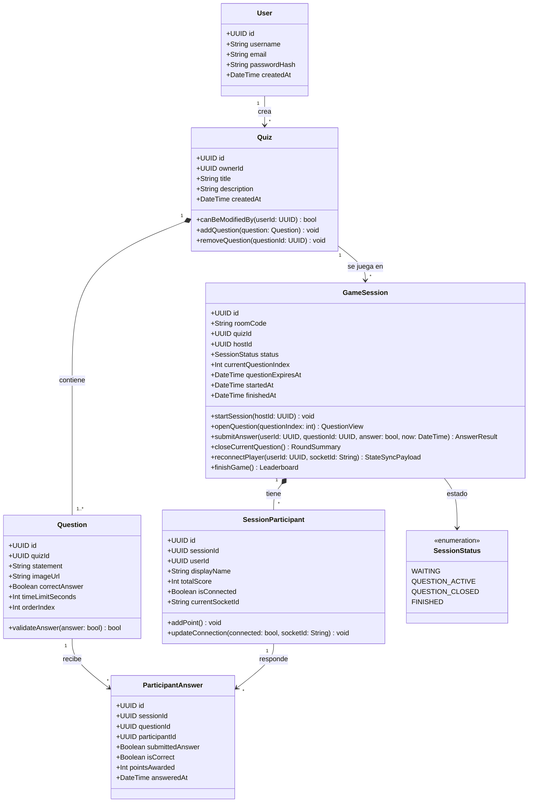
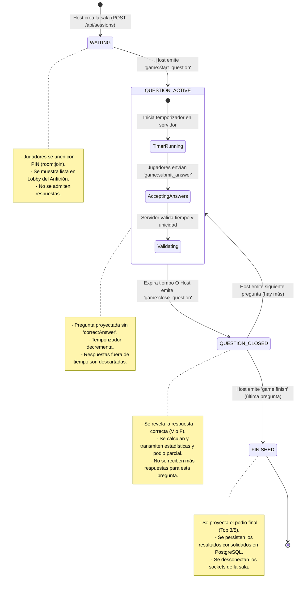

# 📐 Diagrama de Clases y Máquina de Estados

Este documento formaliza el modelo de clases de la capa de dominio de `game-service` y el ciclo de vida de una sesión de juego mediante una máquina de estados finitos.

---

## 🏛️ 1. Diagrama de Clases del Dominio

---

## 🔄 2. Máquina de Estados de la Sala de Juego (`GameSession`)

El comportamiento de la partida se modela estrictamente a través de transiciones de estado deterministas:

---

## ⚙️ 3. Métodos Clave y Lógica Interna

### `GameSession.openQuestion(questionIndex: number)`
- **Validación:** `this.status` debe ser `WAITING` o `QUESTION_CLOSED`.
- **Efectos:**
  - `this.currentQuestionIndex = questionIndex`.
  - `this.status = SessionStatus.QUESTION_ACTIVE`.
  - `this.questionExpiresAt = new Date(Date.now() + question.timeLimitSeconds * 1000)`.
- **Salida:** Payload de socket `game:question_opened` sanitizado (sin revelar `correctAnswer`).

### `GameSession.submitAnswer(...)`
- **Validación:**
  1. `this.status === SessionStatus.QUESTION_ACTIVE`.
  2. `now <= this.questionExpiresAt`.
  3. `!this.answeredUsers.has(userId)`.
- **Efectos:**
  - Registra a `userId` en `answeredUsers`.
  - Determina si `answer === question.correctAnswer`.
  - Si es correcto, incrementa `participant.totalScore += 1`.
- **Salida:** `{ isCorrect: boolean, points: number }`.

---

## 🔗 Enlaces Relacionados
- [[00 - MOC ProfeLink|Volver al MOC]]
- [[Modelo de Datos (ERD)|Ver Esquema de Base de Datos]]
- [[Diseno Interno (Arquitectura en Capas - Layers)|Ver Arquitectura en Capas (Layers)]]
- [[03 - Contratos y Especificaciones/Eventos WebSockets (Socket.io)|Ver Eventos de Socket.io]]
