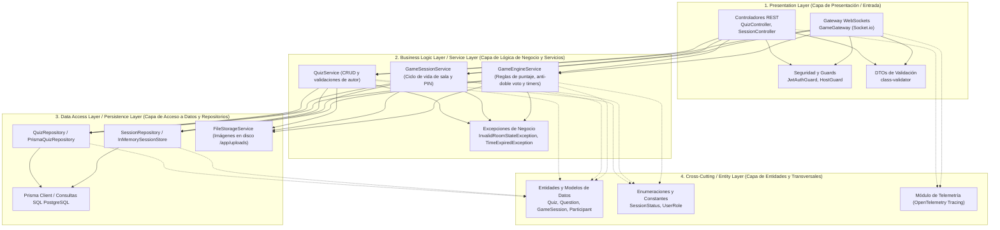

# 🥞 Diseño Interno: Arquitectura en Capas (Layered Architecture - Layers)

A nivel de organización interna dentro de los microservicios (especialmente en `game-service` y `auth-service`), el código se estructura adoptando el patrón clásico y recomendado de **Arquitectura en Capas (Layered Architecture / N-Layers)** en **NestJS**. 

Este patrón establece un flujo de dependencias unidireccional y jerárquico: las peticiones entran por la capa superior y descienden progresivamente, asegurando una separación clara de responsabilidades (SoC).

---

## 🎯 1. Diagrama de la Arquitectura en Layers



---

## 📂 2. Estructura de Directorios en `apps/game-service`

Siguiendo la convención idiomática de NestJS para **Layered Architecture**:

```
apps/game-service/src/
├── presentation/                 # 1. CAPA DE PRESENTACIÓN (Presentation Layer)
│   ├── controllers/
│   │   ├── quiz.controller.ts
│   │   └── session.controller.ts
│   ├── gateways/
│   │   └── game.gateway.ts       # Manejador de eventos Socket.io
│   ├── dtos/
│   │   ├── create-quiz.dto.ts
│   │   ├── submit-answer.dto.ts
│   │   └── join-room.dto.ts
│   └── guards/
│       ├── jwt-audience.guard.ts
│       └── room-host.guard.ts
│
├── services/                     # 2. CAPA DE LÓGICA DE NEGOCIO (Business Logic Layer)
│   ├── quiz.service.ts           # Reglas de administración y propiedad de cuestionarios
│   ├── game-session.service.ts   # Coordinación de partidas y transiciones de estado
│   ├── game-engine.service.ts    # Algoritmo de puntuación, validación de tiempos y anti-doble voto
│   └── room-manager.service.ts   # Estado volátil de participantes y salas activas
│
├── persistence/                  # 3. CAPA DE ACCESO A DATOS (Data Access / Persistence Layer)
│   ├── prisma.service.ts         # Conexión y transacciones a PostgreSQL
│   ├── repositories/
│   │   ├── quiz.repository.ts
│   │   ├── session.repository.ts
│   │   └── in-memory-room.store.ts # Almacén rápido para estado de sockets y temporizadores
│   └── storage/
│       └── local-file-storage.service.ts # Guardado persistente de imágenes (/app/uploads)
│
├── entities/                     # 4. CAPA DE ENTIDADES (Domain Model / Entities Layer)
│   ├── quiz.entity.ts
│   ├── question.entity.ts
│   ├── game-session.entity.ts
│   ├── participant.entity.ts
│   └── enums/
│       ├── session-status.enum.ts # WAITING, QUESTION_ACTIVE, QUESTION_CLOSED, FINISHED
│       └── user-role.enum.ts
│
└── common/                       # CAPA TRANSVERSAL (Cross-Cutting Concerns)
    ├── exceptions/
    │   ├── room-not-found.exception.ts
    │   ├── answer-time-expired.exception.ts
    │   └── already-answered.exception.ts
    ├── filters/
    │   └── ws-exception.filter.ts
    └── telemetry/
        └── otel-tracing.interceptor.ts
```

---

## 🔍 3. Responsabilidades Detalladas por Capa (Layers)

### 3.1 Presentation Layer (Capa de Presentación)
- **Propósito:** Ser el punto de entrada para los clientes web externos e internos.
- **Componentes:**
  - `QuizController` y `SessionController`: Mapean rutas HTTP (`/api/quizzes`, `/api/sessions`), documentadas con decoradores de **OpenAPI/Scalar**.
  - `GameGateway`: Expone los listeners de Socket.io (`@SubscribeMessage('room:join')`, `@SubscribeMessage('game:submit_answer')`).
  - `JwtAudienceGuard`: Intercepta la petición HTTP o el handshake del WebSocket para validar que el token provisto contenga la firma válida y el claim `aud: "profelink-game-api"`.
- **Regla:** Esta capa **no contiene reglas de negocio**. Solo valida sintaxis de entrada (DTOs con `class-validator`) y delega inmediatamente a la Capa de Servicios.

### 3.2 Business Logic / Service Layer (Capa de Lógica de Negocio)
- **Propósito:** Contener y ejecutar todas las reglas del juego y del negocio.
- **Responsabilidades clave:**
  1. **Algoritmo de Puntuación:** Calcula $1$ punto si la respuesta coincide con la correcta y llegó dentro del tiempo límite ($\text{now} \le \text{expiresAt}$), o $0$ puntos si falló o expiró.
  2. **Anti-Doble Votación:** Lleva el control en memoria (`Set<userId>`) para rechazar reenvíos de la misma pregunta por parte de un jugador.
  3. **Temporizador Confiable:** Inicia el conteo en el servidor y determina cuándo cerrar la ronda, evitando depender del reloj del cliente.
  4. **Reconexión:** Identifica si un participante reconectado ya figuraba en la sesión y genera el payload de sincronización (`state_sync`) sin duplicar al jugador.
- **Regla:** Esta capa no conoce detalles de protocolos HTTP ni WebSockets; opera con objetos y tipos de TypeScript.

### 3.3 Data Access Layer (Capa de Acceso a Datos / Persistencia)
- **Propósito:** Abstraer el almacenamiento relacional y de archivos.
- **Componentes:**
  - `PrismaService` y Repositorios: Ejecutan sentencias seguras contra PostgreSQL (guardado de partidas finalizadas, consultas históricas de resultados, CRUD de preguntas).
  - `InMemoryRoomStore`: Estructura en memoria optimizada para acceder al estado de las salas activas con latencia inferior a $1\text{ ms}$.
  - `LocalFileStorageService`: Gestiona la escritura de archivos multipart (`.jpg`, `.png`, `.webp`, $\le 5\text{MB}$) en el volumen persistente Docker `/app/uploads`.

### 3.4 Entity & Common Layer (Capa de Entidades y Transversales)
- Modelos canónicos de datos compartidos entre servicios y repositorios.
- Máquina de estados de la sala:
  $$\text{WAITING} \longrightarrow \text{QUESTION\_ACTIVE} \longrightarrow \text{QUESTION\_CLOSED} \longrightarrow \text{FINISHED}$$

---

## 🧪 4. Estrategia de Pruebas en Arquitectura por Capas (Jest)

La separación en capas simplifica radicalmente las pruebas con **Jest**:

1. **Pruebas Unitarias de la Capa de Servicios (`*.service.spec.ts`):**
   - Se prueba `GameEngineService` y `GameSessionService` inyectando mocks simples de los repositorios (`jest.fn()`).
   - Permite comprobar todas las reglas de puntuación, rechazo de respuestas fuera de tiempo y reconexión en milisegundos sin arrancar PostgreSQL ni Socket.io.
2. **Pruebas de Integración de Capa de Presentación (`*.controller.spec.ts` y `*.gateway.spec.ts`):**
   - Verifican que los DTOs rechacen campos inválidos (`400 Bad Request`) y que los Guards bloqueen peticiones sin audiencia (`401 Unauthorized`).
3. **Pruebas E2E (`*.e2e-spec.ts`):**
   - Evalúan la interacción vertical completa (Presentación $\rightarrow$ Servicios $\rightarrow$ Base de Datos en memoria / Docker).

---

## 🗣️ 5. Justificación para la Defensa Oral ante el Profesor

> [!abstract] Pregunta de Examen: "¿Qué arquitectura interna utilizaron y por qué la eligieron?"
> **Respuesta modelo:**
> *"Utilizamos una **Arquitectura en Capas (Layered Architecture - Layers)**. Separamos el sistema en **Capa de Presentación** (controladores REST y Gateway de WebSockets con Guards de JWT), **Capa de Servicios o Lógica de Negocio** (donde residen las reglas de puntuación, el temporizador del servidor y la prevención de doble voto) y **Capa de Persistencia o Acceso a Datos** (repositorios relacionales con PostgreSQL y almacenamiento en volumen de disco).*
> 
> *Elegimos este diseño porque es el estándar canónico en NestJS, garantiza una clara separación de responsabilidades (Separation of Concerns), facilita el testing unitario con Jest aislando la lógica de negocio mediante inyección de dependencias y asegura un código limpio, mantenible y escalable."*

---

## 🔗 Enlaces Relacionados
- [[00 - MOC ProfeLink|Volver al MOC]]
- [[Arquitectura del Sistema|Arquitectura General del Sistema]]
- [[Modelo de Datos (ERD)|Modelo Relacional de Datos]]
- [[Diagrama de Clases|Diagrama de Clases y Estados]]
- [[05 - Calidad y Pruebas/Estrategia de Pruebas Unitarias (Jest)|Pruebas Unitarias de Capas en Jest]]
