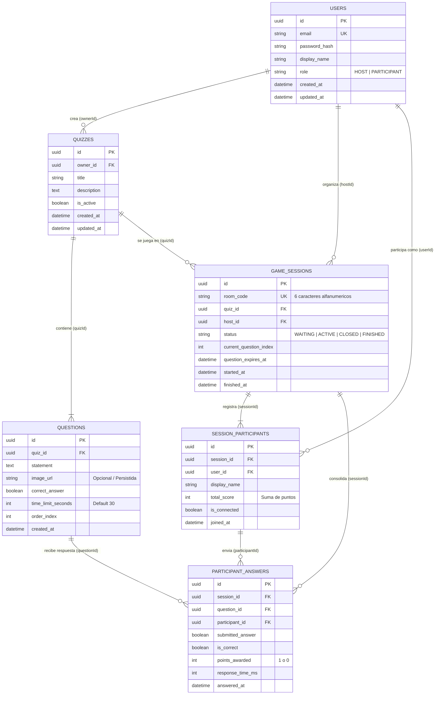

# 🗄️ Modelo de Datos: Esquema Relacional (ERD)

Este documento detalla la estructura relacional de la base de datos PostgreSQL, los esquemas de separación lógica entre `auth-service` y `game-service`, y los tipos de datos requeridos para garantizar la persistencia de usuarios, cuestionarios, sesiones y estadísticas históricas.

---

## 📊 Diagrama Entidad-Relación (ERD)



---

## 📑 Diccionario de Datos

### 1. Tabla `users` (Gestionada por `auth-service`)
| Campo | Tipo | Restricciones | Descripción |
| :--- | :--- | :--- | :--- |
| `id` | UUID | PK, Default `gen_random_uuid()` | Identificador universal único del usuario. |
| `email` | VARCHAR(255) | UNIQUE, NOT NULL | Correo electrónico institucional o personal. |
| `password_hash` | VARCHAR(255) | NOT NULL | Hash criptográfico (bcrypt/argon2). |
| `display_name` | VARCHAR(100) | NOT NULL | Nombre y apellido que se mostrará en las salas de juego. |
| `role` | VARCHAR(20) | NOT NULL, Default `'PARTICIPANT'` | Rol asignado (`HOST` para docentes, `PARTICIPANT` para alumnos). |
| `created_at` | TIMESTAMPTZ | NOT NULL, Default `NOW()` | Fecha y hora de registro. |

### 2. Tabla `quizzes` (Gestionada por `game-service`)
| Campo | Tipo | Restricciones | Descripción |
| :--- | :--- | :--- | :--- |
| `id` | UUID | PK | Identificador del cuestionario. |
| `owner_id` | UUID | NOT NULL | Referencia al `users.id` del docente creador. |
| `title` | VARCHAR(150) | NOT NULL | Título del quiz (ej. "Evaluación 1: Programación Funcional"). |
| `description` | TEXT | NULL | Contexto o instrucciones generales. |
| `created_at` | TIMESTAMPTZ | NOT NULL | Fecha de creación. |

### 3. Tabla `questions` (Gestionada por `game-service`)
| Campo | Tipo | Restricciones | Descripción |
| :--- | :--- | :--- | :--- |
| `id` | UUID | PK | Identificador de la pregunta. |
| `quiz_id` | UUID | FK `quizzes.id`, ON DELETE CASCADE | Cuestionario al que pertenece. |
| `statement` | TEXT | NOT NULL | Enunciado de la pregunta. |
| `image_url` | VARCHAR(500) | NULL | Ruta pública de la imagen de apoyo (`/uploads/...`). |
| `correct_answer`| BOOLEAN | NOT NULL | Valor booleano verdadero (`true`) o falso (`false`). |
| `time_limit_seconds` | INT | NOT NULL, Default `30` | Límite de tiempo otorgado para responder. |
| `order_index` | INT | NOT NULL | Secuencia ordinal de aparición en la partida. |

### 4. Tabla `game_sessions` (Gestionada por `game-service`)
| Campo | Tipo | Restricciones | Descripción |
| :--- | :--- | :--- | :--- |
| `id` | UUID | PK | Identificador de la sesión de juego. |
| `room_code` | VARCHAR(8) | UNIQUE, NOT NULL | Código PIN para unirse (ej. `PL-4921`). |
| `quiz_id` | UUID | FK `quizzes.id` | Cuestionario seleccionado. |
| `host_id` | UUID | NOT NULL | Docente anfitrión moderador. |
| `status` | VARCHAR(20) | NOT NULL | Estado actual de la sala (`WAITING`, `ACTIVE`, `FINISHED`). |
| `started_at` | TIMESTAMPTZ | NULL | Momento en que el anfitrión dio inicio. |
| `finished_at`| TIMESTAMPTZ | NULL | Momento en que concluyó la última pregunta. |

### 5. Tabla `session_participants`
| Campo | Tipo | Restricciones | Descripción |
| :--- | :--- | :--- | :--- |
| `id` | UUID | PK | Identificador del jugador en esta sesión. |
| `session_id` | UUID | FK `game_sessions.id`, ON DELETE CASCADE | Sala a la que pertenece. |
| `user_id` | UUID | NOT NULL | Identificador del usuario. |
| `display_name` | VARCHAR(100) | NOT NULL | Nombre proyectado en el podio. |
| `total_score` | INT | NOT NULL, Default `0` | Sumatoria final de respuestas acertadas a tiempo. |
| `is_connected`| BOOLEAN | NOT NULL, Default `TRUE` | Estado de conexión en tiempo real. |

### 6. Tabla `participant_answers`
| Campo | Tipo | Restricciones | Descripción |
| :--- | :--- | :--- | :--- |
| `id` | UUID | PK | Identificador del registro de respuesta. |
| `session_id` | UUID | FK `game_sessions.id` | Partida en curso. |
| `question_id`| UUID | FK `questions.id` | Pregunta evaluada. |
| `participant_id`| UUID | FK `session_participants.id` | Jugador que contestó. |
| `submitted_answer` | BOOLEAN | NOT NULL | Elección enviada (`true` o `false`). |
| `is_correct` | BOOLEAN | NOT NULL | Evaluación calculada por el servidor. |
| `points_awarded` | INT | NOT NULL | $1$ si acertó a tiempo, $0$ si falló o expiró. |
| `answered_at`| TIMESTAMPTZ | NOT NULL | Timestamp oficial del servidor. |

> [!important] Restricción de Unicidad (Anti-Double Voting)
> Para salvaguardar la integridad de la base de datos frente a condiciones de carrera, se aplica un índice único compuesto:
> ```sql
> CREATE UNIQUE INDEX uq_participant_question ON participant_answers (session_id, question_id, participant_id);
> ```

---

## 🔗 Enlaces Relacionados
- [[00 - MOC ProfeLink|Volver al MOC]]
- [[Diagrama de Clases|Ver Diagrama de Clases del Dominio]]
- [[Diseno Interno (Arquitectura en Capas - Layers)|Diseño Interno: Arquitectura en Capas (Layers)]]
- [[04 - Infraestructura y Despliegue/Docker y Compose|Persistencia con Volúmenes en Docker]]
