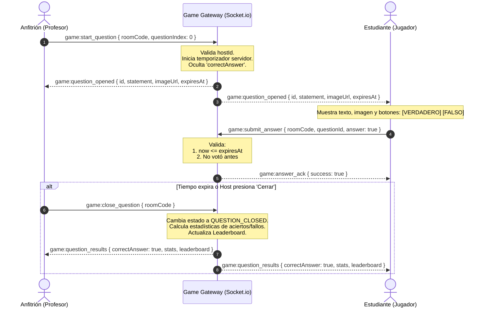
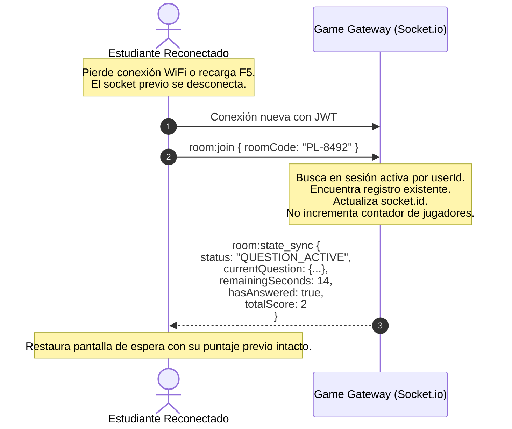

# ⚡ Eventos WebSockets: Protocolo en Tiempo Real (Socket.io)

La interacción en vivo entre el docente (anfitrión) y los estudiantes (participantes) se gestiona a través de una conexión persistente bidireccional usando **Socket.io** sobre `game-service` (Puerto `3002`).

---

## 🔒 1. Handshake y Autenticación del Socket

Al inicializar la conexión, el cliente debe proveer el token JWT en el objeto de autenticación del handshake:

```typescript
import { io } from 'socket.io-client';

const socket = io('http://localhost:3002', {
  auth: {
    token: 'Bearer eyJhbGciOiJIUzI1NiIsInR5cCI6IkpXVCJ9...'
  },
  transports: ['websocket']
});
```

El servidor valida que el token sea auténtico y contenga el claim `aud: "profelink-game-api"`. Si la validación falla, la conexión se rechaza con un error de autorización.

---

## 📋 2. Diccionario Completo de Eventos

| Evento | Dirección | Emisor | Payload Principal | Descripción |
| :--- | :--- | :--- | :--- | :--- |
| `room:join` | Cliente $\rightarrow$ Servidor | Host / Player | `{ roomCode: string }` | Suscribe el socket al room de Socket.io. Si el usuario ya existía, ejecuta **reconexión**. |
| `room:state_sync` | Servidor $\rightarrow$ Cliente | Servidor | `{ status, currentQuestion, score, hasAnswered }` | Emisión privada al cliente reconectado para restaurar su estado visual exacto. |
| `room:participant_joined` | Servidor $\rightarrow$ Sala | Servidor | `{ participants: ParticipantView[] }` | Actualiza la lista de jugadores conectados en la vista del lobby. |
| `game:start_question` | Cliente $\rightarrow$ Servidor | Anfitrión | `{ roomCode: string, questionIndex: number }` | El host abre una pregunta e inicializa el timer en el servidor. |
| `game:question_opened` | Servidor $\rightarrow$ Sala | Servidor | `{ questionId, statement, imageUrl, timeLimit, expiresAt }` | Proyecta la pregunta a todos (**sin el campo `correctAnswer`**). |
| `game:submit_answer` | Cliente $\rightarrow$ Servidor | Jugador | `{ roomCode, questionId, answer: boolean }` | Envío de respuesta binaria (`true`/`false`). |
| `game:answer_ack` | Servidor $\rightarrow$ Jugador | Servidor | `{ success: boolean, message?: string }` | Confirmación privada de recepción de respuesta. |
| `game:close_question` | Cliente $\rightarrow$ Servidor / Auto | Host / Timer | `{ roomCode: string }` | Cierra la ventana de recepción de respuestas de la ronda. |
| `game:question_results` | Servidor $\rightarrow$ Sala | Servidor | `{ correctAnswer: boolean, stats, leaderboard }` | Revela si era V o F, estadísticas globales y tabla parcial. |
| `game:finish` | Cliente $\rightarrow$ Servidor | Anfitrión | `{ roomCode: string }` | Finaliza la partida, persiste en BD y envía el podio final. |

---

## 🔄 3. Diagramas de Secuencia

### 3.1 Flujo de una Ronda de Pregunta



---

### 3.2 Flujo de Reconexión de Participante



---

## 🔗 Enlaces Relacionados
- [[00 - MOC ProfeLink|Volver al MOC]]
- [[Game Service API (OpenAPI)|Ver APIs REST de Game Service]]
- [[01 - Requerimientos y Alcance/Reglas del Juego y Negocio|Reglas de Juego y Tiempos]]
- [[05 - Calidad y Pruebas/Casos de Prueba de Juego|Pruebas de WebSockets con Jest]]
