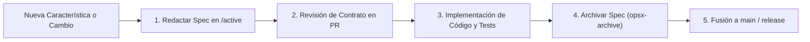

# 📑 OpenSpec y Gestión de Pull Requests (PRs)

Para asegurar la trazabilidad del diseño y evitar discrepancias entre los miembros del equipo, el proyecto adopta la metodología **OpenSpec**. Cada incremento de software o cambio contractual debe originarse en un documento de especificación formal antes de su fusión al repositorio principal.

---

## 📂 1. Organización del Directorio `/openspec`

El repositorio contiene en su raíz la carpeta `/openspec`:

```
profelink-monorepo/
├── openspec/
│   ├── active/                    # Especificaciones en redacción / desarrollo
│   │   ├── 001-jwt-audience.md
│   │   └── 002-reconnection-flow.md
│   ├── archived/                  # Especificaciones completadas y fusionadas
│   │   └── 000-initial-architecture.md
│   └── templates/
│       └── spec-template.md       # Plantilla base para nuevas especificaciones
```

---

## 🔄 2. Ciclo de Vida de una Especificación (OpenSpec Workflow)



1. **Redacción:** Se crea un archivo bajo `/openspec/active/` detallando el problema, el contrato de API/evento y los criterios de aceptación.
2. **Revisión temprana:** Se abre un Pull Request preliminar donde los compañeros revisan los esquemas antes de codificar la lógica.
3. **Desarrollo TDD:** Se escriben las pruebas en **Jest** acordes a la especificación y se implementa la solución en NestJS/React.
4. **Archivo:** Al cumplir la definición de terminado (DoD), se traslada la especificación a `/openspec/archived/`.

---

## 📋 3. Plantilla de Pull Request (PR Template)

Para cada integración a la rama principal, se exige completar la siguiente lista de verificación:

```markdown
### 📌 Resumen del Cambio
- [ ] Breve descripción de la funcionalidad agregada o corregida.
- [ ] Enlace a la especificación en `openspec/active/`.

### 🛡️ Contratos y Seguridad
- [ ] ¿Afecta el contrato de `auth-service` o `game-service`?
- [ ] ¿Se validó el claim `aud: "profelink-game-api"` en los nuevos endpoints/sockets?
- [ ] ¿Se actualizó la documentación de Scalar en `/reference`?

### 🧪 Calidad y Pruebas
- [ ] Pruebas unitarias de dominio agregadas en Jest (`pnpm test`).
- [ ] Pruebas de integración o WebSocket cubiertas.
- [ ] Cobertura de código mantenida o incrementada (`pnpm test:cov`).

### 🐳 Despliegue y Reproducibilidad
- [ ] ¿Requiere nuevas variables en `.env.example`?
- [ ] ¿Las migraciones de PostgreSQL se ejecutan limpiamente?
- [ ] Verificado localmente con `./start.sh` o `docker compose up`.
```

---

## 🔗 Enlaces Relacionados
- [[00 - MOC ProfeLink|Volver al MOC]]
- [[Auth Service API (OpenAPI)|Ver Contratos de Auth]]
- [[Game Service API (OpenAPI)|Ver Contratos de Game]]
- [[06 - Entrega y Defensa/Bitacora de Aportes|Registro en la Bitácora de Aportes]]
