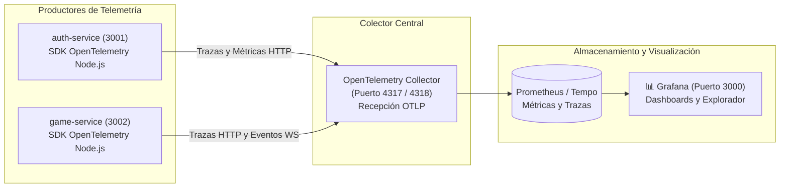

# 📊 Observabilidad: OpenTelemetry y Grafana

La evaluación del proyecto exige evidenciar la monitorización del sistema durante la ejecución en vivo. La arquitectura implementa observabilidad de primer nivel basada en el estándar **OpenTelemetry (OTel)** y paneles visuales en **Grafana**.

---

## 🎯 1. Arquitectura de Observabilidad



---

## 📡 2. Instrumentación en NestJS (`tracing.ts`)

Ambos microservicios cargan el SDK de OpenTelemetry antes de levantar el módulo raíz de NestJS:

```typescript
import { NodeSDK } from '@opentelemetry/sdk-node';
import { getNodeAutoInstrumentations } from '@opentelemetry/auto-instrumentations-node';
import { OTLPTraceExporter } from '@opentelemetry/exporter-trace-otlp-http';
import { OTLPMetricExporter } from '@opentelemetry/exporter-metrics-otlp-http';
import { PeriodicExportingMetricReader } from '@opentelemetry/sdk-metrics';

const otelEndpoint = process.env.OTEL_EXPORTER_OTLP_ENDPOINT || 'http://localhost:4318';

export const otelSdk = new NodeSDK({
  serviceName: process.env.OTEL_SERVICE_NAME || 'profelink-service',
  traceExporter: new OTLPTraceExporter({
    url: `${otelEndpoint}/v1/traces`,
  }),
  metricReader: new PeriodicExportingMetricReader({
    exporter: new OTLPMetricExporter({
      url: `${otelEndpoint}/v1/metrics`,
    }),
    exportIntervalMillis: 5000,
  }),
  instrumentations: [
    getNodeAutoInstrumentations({
      '@opentelemetry/instrumentation-fs': { enabled: false }, // Reduce ruido
      '@opentelemetry/instrumentation-http': { enabled: true },
    }),
  ],
});

otelSdk.start();
```

---

## 📈 3. Métricas Críticas a Demostrar en Clase

Durante la defensa, se proyectará el dashboard de Grafana (`http://localhost:3000`) mostrando:

1. **Conexiones Activas de WebSockets:**
   - Métrica: `profelink_active_websocket_connections`.
   - Evidencia: Subida escalonada conforme los estudiantes se unen a la sala con su PIN.
2. **Latencia de Respuesta por Pregunta:**
   - Métrica: `profelink_answer_submission_duration_ms`.
   - Evidencia: Tiempos de procesamiento del servidor $\le 15\text{ ms}$ por respuesta.
3. **Distribución de Aciertos vs. Fallos:**
   - Métrica: `profelink_answers_total{result="correct|incorrect"}`.
   - Evidencia: Conteo en tiempo real de participantes que acertaron la pregunta activa.
4. **Tasa de Errores HTTP:**
   - Métrica: `http_requests_total{status=~"5.."}`.
   - Evidencia: Estabilidad en 0 errores durante la partida.

---

## 🔍 4. Inspección de Trazas Distribuidas (Distributed Tracing)

En caso de que el profesor pregunte cómo se valida la integración entre servicios:
1. Abrir **Grafana Explore** $\rightarrow$ Datasource **Tempo**.
2. Buscar trazas del endpoint `POST /api/sessions/{id}/results`.
3. Evidenciar la traza donde un cliente externo envía el token emitido por `auth-service` y el `game-service` procesa la consulta, mostrando el desglose de tiempo por cada span interno (validación JWT, consulta a base de datos, serialización JSON).

---

## 🔗 Enlaces Relacionados
- [[00 - MOC ProfeLink|Volver al MOC]]
- [[Docker y Compose|Contenedor de OTel y Grafana]]
- [[06 - Entrega y Defensa/Guion de Demostracion en Clase|Paso a Paso de Demostración en Clase]]
