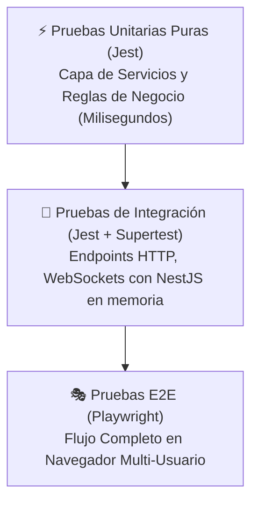

# 🧪 Estrategia de Pruebas Unitarias con Jest

Para certificar que el sistema cumple con todas las reglas de negocio sin fallos durante la clase, la estrategia de testing se apoya intensamente en **Jest**, aprovechando que la **Arquitectura en Capas (Layers)** permite aislar la lógica de negocio en la Capa de Servicios (`*Service`) desacoplada de la infraestructura y el transporte.

---

## 🎯 1. Pirámide de Pruebas del Proyecto



---

## 🔬 2. Pruebas Unitarias de Dominio (`*.spec.ts`)

Estas pruebas se ejecutan de manera instantánea ($\le 100\text{ ms}$) y no requieren mocks complejos ni conexión a PostgreSQL:

### 2.1 Reglas de Puntuación y Respuestas (`GameSession.spec.ts`)
```typescript
describe('GameSession - Domain Entity', () => {
  let session: GameSession;
  const mockQuestion: Question = {
    id: 'q-1',
    statement: '¿Las funciones puras son deterministas?',
    correctAnswer: true,
    timeLimitSeconds: 15,
  };

  beforeEach(() => {
    session = new GameSession({
      id: 'sess-123',
      roomCode: 'PL-1010',
      hostId: 'host-1',
      questions: [mockQuestion],
    });
    session.startSession('host-1');
    session.openQuestion(0);
  });

  it('debe asignar 1 punto cuando la respuesta es correcta y está dentro del tiempo límite', () => {
    const onTime = new Date(Date.now() + 5000); // 5s dentro de los 15s
    const result = session.submitAnswer('user-1', 'q-1', true, onTime);

    expect(result.isCorrect).toBe(true);
    expect(result.points).toBe(1);
  });

  it('debe asignar 0 puntos cuando la respuesta es incorrecta', () => {
    const onTime = new Date(Date.now() + 5000);
    const result = session.submitAnswer('user-2', 'q-1', false, onTime);

    expect(result.isCorrect).toBe(false);
    expect(result.points).toBe(0);
  });

  it('debe rechazar una segunda respuesta del mismo participante en la misma pregunta (anti-doble puntaje)', () => {
    const now = new Date();
    session.submitAnswer('user-1', 'q-1', true, now);

    expect(() => {
      session.submitAnswer('user-1', 'q-1', true, now);
    }).toThrow('ALREADY_ANSWERED');
  });

  it('debe rechazar respuestas recibidas después de que el tiempo expiró', () => {
    const expiredTime = new Date(Date.now() + 20000); // 20s > 15s
    
    expect(() => {
      session.submitAnswer('user-3', 'q-1', true, expiredTime);
    }).toThrow('ANSWER_TIME_EXPIRED');
  });
});
```

---

### 2.2 Autorización y Control de Sala (`RoomAuthorization.spec.ts`)
```typescript
describe('RoomAuthorization - Guards & UseCases', () => {
  it('debe prohibir a un participante avanzar o cerrar la pregunta de la sala', () => {
    const session = new GameSession({ id: 's-1', hostId: 'teacher-uuid' });
    
    expect(() => {
      session.validateHostControl('student-uuid');
    }).toThrow('FORBIDDEN_HOST_ACTION');
  });
});
```

---

### 2.3 Lógica de Reconexión Transparente (`Reconnection.spec.ts`)
```typescript
describe('Reconnection Logic', () => {
  it('debe mantener el puntaje acumulado y el estado cuando un participante se reconecta', () => {
    const session = new GameSession({ id: 's-1', hostId: 't-1' });
    session.addParticipant('u-1', 'María', 'socket-old');
    session.recordScore('u-1', 3);

    // Simula reconexión con nuevo socketId
    const syncState = session.reconnectPlayer('u-1', 'socket-new');

    expect(session.getParticipants().length).toBe(1); // No duplicado
    expect(session.getParticipant('u-1').totalScore).toBe(3);
    expect(syncState.totalScore).toBe(3);
  });
});
```

---

### 2.4 Validación de Imágenes (`ImageValidator.spec.ts`)
```typescript
describe('ImageValidator', () => {
  it('debe aceptar imágenes PNG/JPG menores a 5MB y rechazar archivos ejecutables o mayores al límite', () => {
    expect(ImageValidator.isValidMime('image/png')).toBe(true);
    expect(ImageValidator.isValidMime('image/jpeg')).toBe(true);
    expect(ImageValidator.isValidMime('application/x-msdownload')).toBe(false);

    expect(ImageValidator.isSizeAllowed(4 * 1024 * 1024)).toBe(true); // 4MB OK
    expect(ImageValidator.isSizeAllowed(6 * 1024 * 1024)).toBe(false); // 6MB Rechazado
  });
});
```

---

## ⚡ 3. Scripts de Ejecución en `package.json`

```json
{
  "scripts": {
    "test": "jest",
    "test:watch": "jest --watch",
    "test:cov": "jest --coverage",
    "test:integration": "jest --config ./test/jest-integration.json"
  }
}
```

Durante la defensa, el comando a ejecutar frente al profesor es:
```bash
pnpm test
```
Demostrando que la suite completa corre en segundos con 100% de aserciones en verde.

---

## 🔗 Enlaces Relacionados
- [[00 - MOC ProfeLink|Volver al MOC]]
- [[Casos de Prueba de Juego|Ver Matriz de Comprobaciones en Clase]]
- [[Pruebas E2E (Playwright)|Ver Pruebas de Navegador con Playwright]]
- [[01 - Requerimientos y Alcance/Reglas del Juego y Negocio|Reglas de Negocio Validadas]]
