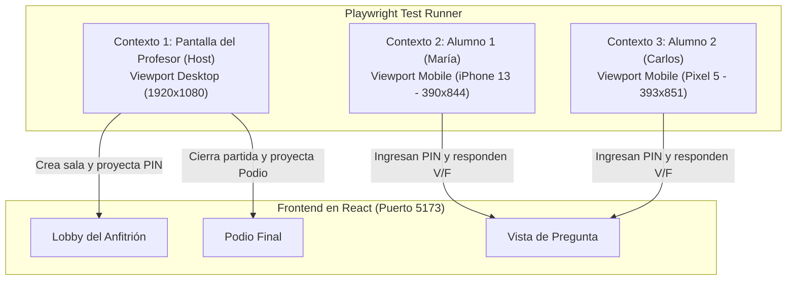

# 🎭 Pruebas End-to-End (E2E) con Playwright

Las pruebas E2E automatizan navegadores reales mediante **Playwright** para simular una partida completa multi-jugador en tiempo real. Esta suite valida la reactividad del frontend en React, la animación del temporizador, la actualización del podio y la sincronización de WebSockets.

---

## 🎯 1. Escenario Multi-Contexto (Anfitrión + 2 Alumnos)

Playwright permite crear múltiples contextos de navegación independientes (`BrowserContext`) dentro de una sola prueba para emular diferentes usuarios interactuando simultáneamente:



---

## 💻 2. Código de la Prueba E2E (`e2e/game-flow.spec.ts`)

```typescript
import { test, expect } from '@playwright/test';

test.describe('Partida Completa en Vivo (Multi-Usuario)', () => {
  test('debe orquestar el flujo desde la creación de la sala hasta el podio final', async ({ browser }) => {
    // 1. Crear contextos aislados
    const hostContext = await browser.newContext();
    const p1Context = await browser.newContext({ viewport: { width: 390, height: 844 } });
    const p2Context = await browser.newContext({ viewport: { width: 390, height: 844 } });

    const hostPage = await hostContext.newPage();
    const p1Page = await p1Context.newPage();
    const p2Page = await p2Context.newPage();

    // 2. Anfitrión inicia sesión y crea la sala
    await hostPage.goto('http://localhost:5173/login');
    await hostPage.fill('input[type="email"]', 'profe@profelink.cr');
    await hostPage.fill('input[type="password"]', 'Password123!');
    await hostPage.click('button[type="submit"]');

    await hostPage.waitForURL('http://localhost:5173/dashboard');
    await hostPage.click('button:has-text("Iniciar Sala")');

    // Extraer PIN generado
    const pinLocator = hostPage.locator('[data-testid="room-pin"]');
    await expect(pinLocator).toBeVisible();
    const roomPin = (await pinLocator.innerText()).trim();

    // 3. Estudiantes se unen con el PIN
    for (const [page, name] of [[p1Page, 'María'], [p2Page, 'Carlos']] as const) {
      await page.goto('http://localhost:5173/join');
      await page.fill('input[placeholder="Código PIN"]', roomPin);
      await page.fill('input[placeholder="Tu Nombre"]', name);
      await page.click('button:has-text("Unirse")');
      await expect(page.locator('text=¡Estás dentro!')).toBeVisible();
    }

    // 4. El anfitrión ve a los 2 jugadores en el Lobby
    await expect(hostPage.locator('text=María')).toBeVisible();
    await expect(hostPage.locator('text=Carlos')).toBeVisible();

    // 5. Anfitrión lanza la primera pregunta
    await hostPage.click('button:has-text("Comenzar Evaluación")');

    // 6. Alumnos ven la pregunta y responden
    // María responde Verdadero (correcta)
    await p1Page.click('button:has-text("VERDADERO")');
    await expect(p1Page.locator('text=Respuesta enviada')).toBeVisible();

    // Carlos responde Falso (incorrecta)
    await p2Page.click('button:has-text("FALSO")');
    await expect(p2Page.locator('text=Respuesta enviada')).toBeVisible();

    // 7. Anfitrión cierra la pregunta
    await hostPage.click('button:has-text("Cerrar Pregunta")');

    // 8. Se revela la respuesta y se actualiza el podio
    await expect(hostPage.locator('text=Respuesta Correcta: VERDADERO')).toBeVisible();
    await expect(hostPage.locator('text=1 acierto / 1 fallo')).toBeVisible();

    // 9. Finalizar partida y proyectar Podio
    await hostPage.click('button:has-text("Finalizar Partida")');
    await expect(hostPage.locator('text=🏆 Podio Final')).toBeVisible();
    await expect(hostPage.locator('text=1er Lugar: María (1 pt)')).toBeVisible();
  });
});
```

---

## 🚀 3. Ejecución de Pruebas con Playwright

```bash
# Ejecutar pruebas en modo headless
pnpm exec playwright test

# Ejecutar con interfaz visual (UI mode) para demostración
pnpm exec playwright test --ui
```

---

## 🔗 Enlaces Relacionados
- [[00 - MOC ProfeLink|Volver al MOC]]
- [[Estrategia de Pruebas Unitarias (Jest)|Pruebas Unitarias con Jest]]
- [[Casos de Prueba de Juego|Casos de Prueba y Comprobaciones]]
- [[06 - Entrega y Defensa/Guion de Demostracion en Clase|Guión de Demostración]]
